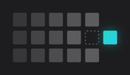

<div align="center">

<picture>
  <source media="(prefers-color-scheme: dark)" srcset="docs/assets/logo-dark.svg">
  <source media="(prefers-color-scheme: light)" srcset="docs/assets/logo-light.svg">
  
</picture>

<h1>Tonie Sync</h1>

<p><strong>A Home Assistant integration that keeps a Creative Tonie in sync with a Navidrome playlist.</strong></p>

<p>
  <a href="https://github.com/derblub/ha-tonie-sync/actions/workflows/ci.yml"></a>
  <a href="https://hacs.xyz/docs/faq/custom_repositories/"></a>
  <a href="https://www.home-assistant.io/"></a>
  <a href="LICENSE"></a>
</p>

<p>
  <a href="#requirements">Requirements</a> ·
  <a href="#installation">Installation</a> ·
  <a href="#setup">Setup</a> ·
  <a href="#how-a-sync-works">How a sync works</a> ·
  <a href="#actions">Actions</a> ·
  <a href="#entities">Entities</a> ·
  <a href="#limitations">Limitations</a> ·
  <a href="CHANGELOG.md">Changelog</a>
</p>

</div>

---

A Creative Tonie holds up to 90 minutes of audio that you upload through the Tonie app or website, one file at a time. If your music already lives on a Navidrome server, keeping a Tonie up to date by hand means downloading, uploading and reordering every song again.

**Tonie Sync** does that from Home Assistant. You pick a Navidrome playlist for each Creative Tonie. On every sync the integration uploads new songs, removes songs that left the playlist and puts the chapters in playlist order. Chapters you added to the Tonie yourself stay where they are.

It talks to Navidrome, or any other server with the Subsonic or OpenSubsonic API, and to the Tonie cloud through the [toniebox integration](https://github.com/git4sim/HA-Toniebox).

## Contents

- [Requirements](#requirements)
- [Installation](#installation)
- [Setup](#setup)
- [How a sync works](#how-a-sync-works)
- [Actions](#actions)
- [Entities](#entities)
- [Diagnostics](#diagnostics)
- [Limitations](#limitations)
- [Privacy](#privacy)
- [Development](#development)
- [Uninstall](#uninstall)

## Requirements

- Home Assistant 2026.10 or newer.
- The HACS integration **toniebox** ([git4sim/HA-Toniebox](https://github.com/git4sim/HA-Toniebox), tested with 4.0.5), set up and loaded. Tonie Sync uses its Tonie cloud client and coordinator and has no login of its own for the Tonie cloud.
- A Navidrome server, or another server with the Subsonic or OpenSubsonic API, that Home Assistant can reach.

## Installation

### HACS

1. HACS → ⋮ → Custom repositories → add `https://github.com/derblub/ha-tonie-sync` with the category *Integration*.
2. Install **Tonie Sync (Navidrome)**.
3. Restart Home Assistant.

### Manually

Copy `custom_components/tonie_sync` to `/config/custom_components/tonie_sync` and restart Home Assistant.

On Home Assistant OS with the *Terminal & SSH* add-on, `./deploy.sh` copies the integration over `ssh` and runs `ha core check`. The host comes from `$HAOS_HOST` (default `haos`). `./deploy.sh --restart` also restarts Home Assistant.

## Setup

1. Settings → Devices & services → Add integration → **Tonie Sync (Navidrome)**.
2. Enter the server URL (for example `http://navidrome.local:4533`), username and password. The integration checks the connection with the Subsonic `ping` call. Use `https://` whenever the server is reachable that way: over plain `http://` anyone on the network path can read the login token and try to recover the password from it (see [Privacy](#privacy)).
3. Open **Configure** on the integration. The options flow lists your Creative Tonies with their current playlist:
   - pick a Tonie, then its playlist and the mode, and you are back at the overview,
   - the “(none)” entry at the top of the playlist list stops syncing that Tonie (its chapters stay),
   - **Sync automatically** checks every playlist every 15 minutes,
   - submitting the overview without a Tonie selected saves.

### Modes

| Mode | What the Tonie holds afterwards |
| --- | --- |
| `append` (default) | The playlist, plus every chapter that did not come from it. Those foreign chapters are never deleted. |
| `replace` | Exactly the playlist. Foreign chapters are removed. |

## How a sync works

### Which chapters belong to the playlist

For every playlist entry the integration stores which chapter on the Tonie belongs to which Navidrome song (Home Assistant store `.storage/tonie_sync.<entry_id>`). A song that appears several times in the playlist counts once per occurrence. Every chapter that is not in this mapping is a **foreign chapter**.

In append mode each foreign chapter is anchored to the managed chapter before it, or to the start of the Tonie, and moves with it. New songs go to their position in the playlist. If the anchor is removed, the foreign chapter moves behind the previous remaining one. On the first sync of a Tonie all foreign chapters therefore stay at the start. A sync without a change to the playlist never changes the order.

### Steps

1. Load the playlist from Navidrome and read the Tonie from the cloud.
2. Plan the new chapter list and run the safety checks below. If one fails, nothing is changed.
3. Download the new songs one at a time and upload each to the Tonie cloud. Only one song is held in memory, at most 150 MB.
4. Read the Tonie again and plan once more. Titles, durations and foreign chapters changed in the meantime are kept. If the new plan would need different uploads, the run stops.
5. Store the mapping as `pending`, then write the final chapter list with **one** request, and refresh the toniebox coordinator.

A sync without changes writes nothing.

### Safety checks

| Situation | State | What happens |
| --- | --- | --- |
| The cloud answer has no valid chapter list, or its chapter count does not match | `error` | Nothing is changed. |
| A chapter or song has no known duration yet, for example while the cloud is still transcoding | `error` | Nothing is changed. Sync again once transcoding has finished. |
| The result does not fit on the Tonie | `too_long` | Nothing is changed. The message says by how much, for example "4 min too long". |
| The playlist is empty, or more than 3 **and** more than half of the chapters would be removed | `needs_confirmation` | Nothing is changed until you run `tonie_sync.sync` with `confirm_removals: true`. |
| Several chapters were mapped and none of them can be found any more, probably because the cloud changed its IDs | `error` | Nothing is changed. |

A Navidrome answer without entries counts as an error unless the playlist reports 0 songs.

### Capacity

A Tonie holds at most 90 minutes and 99 chapters. If the cloud reports smaller limits, those apply. Foreign chapters count in append mode. Existing chapters count with the duration the cloud reports, new songs with their Navidrome duration.

### Transcoding

The integration asks Navidrome for MP3 at 192 kbit/s (`stream`) and falls back to the original file (`download`). After an upload the Tonie cloud transcodes the file and gives the chapter a new ID. The integration remembers fresh uploads as `pending` and finds them again by ID, by a known ID inside the new one, or, for pending uploads only, by exact title and position between their managed neighbours. It never takes over a chapter that was foreign at the last sync. If more than one chapter fits, the run stops with `error`.

New chapters are titled with artist and song title, or just the title when a song has no artist. Existing chapters keep their title, also one you changed in the Tonie app.

### Chapters deleted in the Tonie app

A managed chapter that you delete in the Tonie app is **not** uploaded again. Deleting it was a decision, and uploading it on every sync would undo it. The song shows up in the `excluded_songs` attribute until you remove it from the playlist or run `tonie_sync.sync` with `restore_deleted: true`.

### Interrupted runs

If the final write fails or times out, the integration reads the Tonie again: when the uploaded files are there, the write counts as done. If Home Assistant restarts in between, the next run resolves `pending` the same way, so no song ends up twice on the Tonie.

### Concurrency and automatic sync

One sync per Tonie runs at a time; a second call reports "Sync is already running". With **Sync automatically** the integration reads every playlist every 15 minutes and syncs a Tonie when content, order or mode changed since the last successful sync, or when the last run did not end `up_to_date` (so a `too_long` is checked again once space is free). Tonies are synced one after another.

## Actions

### `tonie_sync.sync`

Syncs the Tonies of the targeted entities or devices. Without a target, it syncs every Tonie with a playlist.

| Field | Default | Meaning |
| --- | --- | --- |
| `restore_deleted` | `false` | Also upload songs whose chapter was deleted in the Tonie app. |
| `confirm_removals` | `false` | Run despite the removal check. |

With `response_variable` you get `results`, one entry per Tonie with `tonie_id`, `name`, `state`, `message`, `uploaded` and `removed`.

```yaml
action: tonie_sync.sync
target:
  entity_id: button.tonie_sync_bedtime_sync
data:
  confirm_removals: true
response_variable: result
```

`tonie_sync.adopt`, `tonie_sync.search_songs` and `tonie_sync.playlist_edit` are admin actions: they change Navidrome playlists or reveal the music library, so only Home Assistant administrators can call them. With more than one Tonie Sync entry, they act on the entry that the Tonie belongs to; where that is not clear, pass `config_entry_id`, otherwise the action fails instead of guessing.

### `tonie_sync.adopt`

Creates a Navidrome playlist from the chapters that are already on a Creative Tonie, without changing the Tonie. Use it when a Tonie was filled by hand before.

| Field | Default | Meaning |
| --- | --- | --- |
| `entity_id` | required | Media player of the Creative Tonie from the toniebox integration. |
| `config_entry_id` | the only entry, or the one that knows the Tonie | Tonie Sync entry (Navidrome account) to use. |
| `playlist_name` | "Tonie" plus the device name | Name of the new playlist. |
| `apply` | `false` | `false` only reports the matches. `true` creates the playlist. |

Each chapter is matched against Navidrome with up to three searches. Titles are compared normalised: lower case, without punctuation, umlauts and bracketed additions such as "Single Edit". A chapter title is also tried as "Artist - Title" at every hyphen. A match is **sure** only with the same core title, a duration within 3 seconds, a matching artist when the title names one, and exactly one such song. Copies of the same recording on several albums count as one; the copy on a real album wins. Everything else is **unsure** (with up to three candidates and a reason) or **none**, and stays a foreign chapter.

With `apply: true` the action stops if there is no sure match, the Tonie already has a playlist or stored mapping, the playlist name exists, or a sync right afterwards would change the Tonie. Otherwise it creates the playlist from the sure matches in chapter order, checks the result, stores the mapping, assigns the playlist to the Tonie in append mode with automatic sync off, and reloads the integration. Nothing is uploaded.

```yaml
action: tonie_sync.adopt
data:
  entity_id: media_player.creative_tonie_bedtime
  apply: false
response_variable: report
```

### `tonie_sync.search_songs`

Searches Navidrome and returns songs with `id`, `artist`, `title`, `album` and `duration`. `count` defaults to 20, at most 100. With several Tonie Sync entries, `config_entry_id` chooses the Navidrome account.

```yaml
action: tonie_sync.search_songs
data:
  query: lullaby
  count: 10
response_variable: songs
```

### `tonie_sync.playlist_edit`

Adds songs to or removes them from the Navidrome playlist of a Tonie and returns `playlist_id`, `added`, `removed` and `songs`. The entry follows from the Tonie Sync entity in `entity_id`. The Tonie itself changes with the next sync.

```yaml
action: tonie_sync.playlist_edit
data:
  entity_id: sensor.tonie_sync_bedtime_status
  add_song_ids: ["<song id from search_songs>"]
  remove_song_ids: []
response_variable: edit
```

## Entities

Each Tonie with a playlist gets its own device, "Tonie Sync" plus the Tonie's name, linked to the Creative Tonie device of the toniebox integration through `via_device_id`.

| Entity | What it does |
| --- | --- |
| `button.tonie_sync_<name>_sync` | Starts a sync in the background. |
| `sensor.tonie_sync_<name>_status` | Enum sensor with the states `pending`, `running`, `up_to_date`, `too_long`, `needs_confirmation` and `error`. |

The status sensor has the attributes `playlist_name`, `songs`, `playlist_minutes`, `total_minutes`, `free_minutes`, `chapters`, `foreign_chapters`, `excluded_songs`, `mode`, `last_sync`, `last_message` and `progress`.

Home Assistant derives the exact entity IDs from the device name and the language at the time they are created.

## Diagnostics

Settings → Devices & services → Tonie Sync → ⋮ → Download diagnostics. The file contains, per Tonie, the raw chapters (`id`, `file`, `title`, `seconds`, `transcoding`), the capacity the cloud reports, the status and the stored mapping. Password, server URL, username and household IDs are redacted, and Tonie IDs are replaced by `tonie_1`, `tonie_2` and so on. Error texts never contain request URLs with the login token. Check the file for anything you would rather not share, such as song titles, before you attach it to a bug report.

## Limitations

- **Toniebox 1 needs to be online.** A box of the first generation fetches new content only when it is connected. Until then it plays what it had.
- **Coupled to the toniebox integration.** Tonie Sync uses internals of the toniebox integration (`hass.data["toniebox"]`, its cloud client and coordinator). All coupling points are in `custom_components/tonie_sync/bridge.py`. If something is missing after an update of that integration, the status sensor reports `error` with a message that names it.
- **Orphaned uploads.** If a run fails after some uploads, nothing is written to the chapter list. The uploaded files are then not attached to any chapter and do not count towards the capacity; whether the Tonie cloud cleans them up is not known. The next run uploads the songs again.
- **Changing the playlist.** With a new playlist, managed chapters that are not in it are removed. Choosing no playlist leaves all chapters on the Tonie.
- **Estimated capacity.** Capacity is planned with the Navidrome duration. After transcoding the cloud may report a slightly different one.

## Privacy

- The Navidrome password is stored in the config entry (`.storage/core.config_entries`), like the credentials of other integrations. The Subsonic API needs it in plain form to derive the per-request token `md5(password + salt)`; the password itself is never sent.
- The token and salt travel in the request URL. Over plain `http://` anyone who can read the traffic can reuse them and attack the password offline, since MD5 is fast to brute-force. Use `https://` for the Navidrome URL wherever possible, and a password you use nowhere else.
- Error messages, the status sensor, the log and diagnostics never contain request URLs with the token.
- Songs go from Navidrome through Home Assistant to the Tonie cloud. No other service is contacted.
- The Tonie cloud login stays with the toniebox integration.

## Development

```console
$ python -m venv .venv
$ .venv/bin/pip install pytest aiohttp
$ .venv/bin/python -m pytest -q
$ .venv/bin/python -m py_compile custom_components/tonie_sync/*.py
```

The tests cover the planner, the sync engine, the matcher and the Subsonic client and run without Home Assistant. CI also runs `hassfest` and the HACS check. See [CONTRIBUTING.md](CONTRIBUTING.md) for more, and the [Code of Conduct](CODE_OF_CONDUCT.md). Security issues go through [SECURITY.md](SECURITY.md).

## Uninstall

1. Delete the integration: Settings → Devices & services → Tonie Sync → Delete. The chapters on the Tonies stay as they are.
2. Remove `/config/custom_components/tonie_sync` (or uninstall it in HACS) and `/config/.storage/tonie_sync.*`, then restart Home Assistant.

## License

[MIT](LICENSE) © Daniel Kurdoghlian, Pushing Pixels

This project is not affiliated with tonies or Navidrome.

---

<div align="center">
  <a href="https://pushingpixels.at">
    <picture>
      <source media="(prefers-color-scheme: dark)" srcset="docs/assets/pushing-pixels-dark.svg">
      <source media="(prefers-color-scheme: light)" srcset="docs/assets/pushing-pixels-light.svg">
      
    </picture>
  </a>
  <p>Built and maintained by <a href="https://pushingpixels.at">Daniel Kurdoghlian</a> at <a href="https://pushingpixels.at">Pushing Pixels</a> in Vienna.<br>
  Need an integration like this for your own systems? I <a href="https://pushingpixels.at/creates/web-apps">build custom software</a>.</p>
</div>
